# NLP 검색 흐름 (CP-01~10)

질문을 입력하면 검색 대상 문단 200개에서 관련성이 높은 문단을 찾는다.

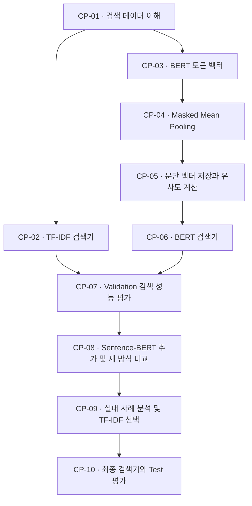

## CP-01. 검색 데이터와 초기 가설

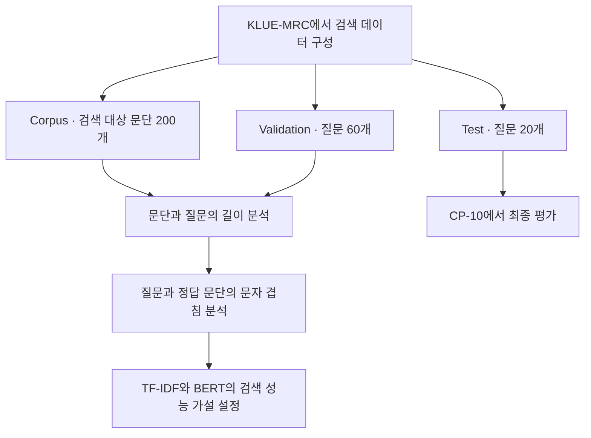

문자 겹침이 높으면 TF-IDF가, 표현은 달라도 의미가 비슷하면 BERT가 유리할 것으로 예상했다.

## CP-02. TF-IDF 검색기

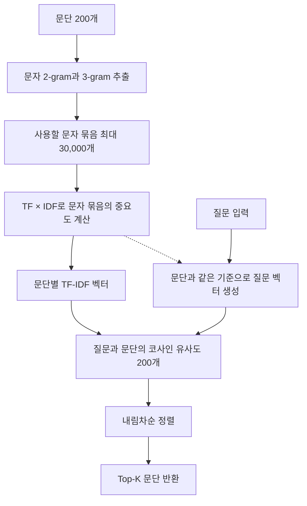

## CP-03. BERT 입력과 토큰 벡터

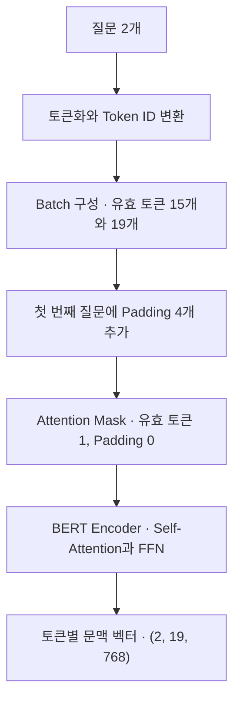

## CP-04. Masked Mean Pooling

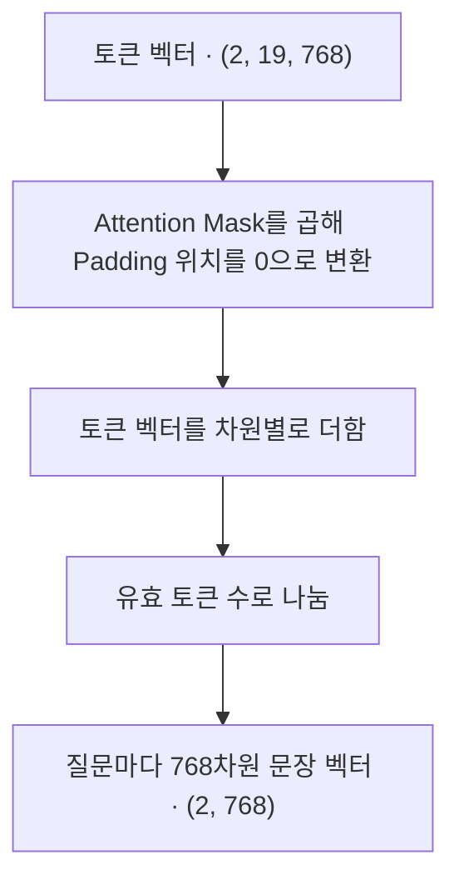

## CP-05. 문단 벡터 만들고 저장하기

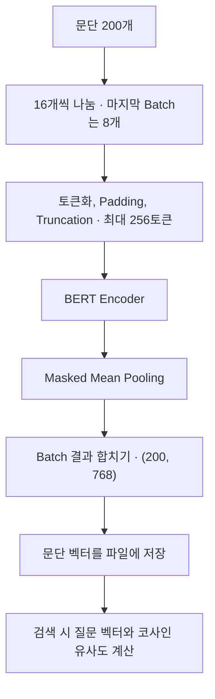

## CP-06. BERT 검색과 질문 벡터 캐시

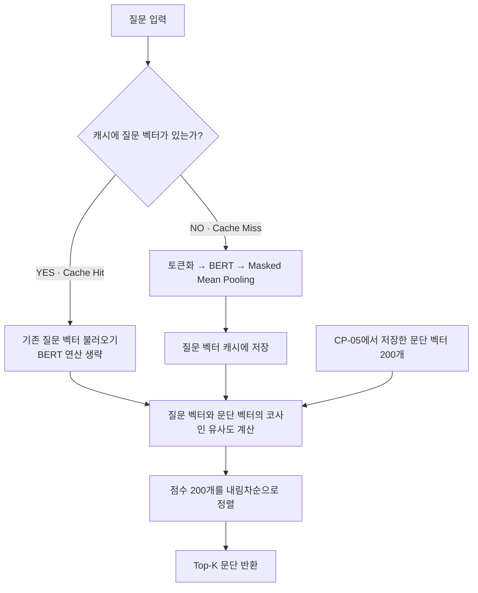

첫 Validation 질문 `QV001`에서 두 검색기 모두 정답 문단 `D015`를 1위로 찾았다. 두 검색기의 유사도는 각각 순위를 매기는 데 쓰고, 전체 성능은 Validation 질문 60개에서 정답 문단이 나온 순위로 평가한다.

## CP-07. TF-IDF와 BERT의 검색 성능 평가

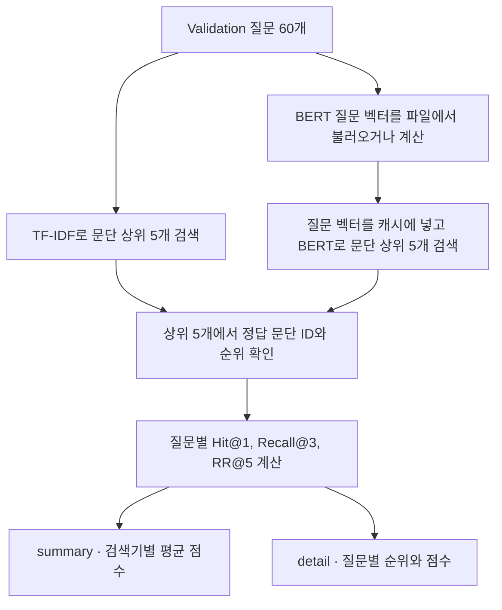

Hit@1은 정답이 1위에 나온 비율이고, Recall@3은 정답이 상위 3개 안에 들어온 비율이다. MRR@5는 정답 순위의 역수를 평균 낸 값이며, 상위 5개에 정답이 없으면 해당 질문의 점수는 0이다. TF-IDF는 60개 중 53개를 1위로 찾았고, BERT는 40개를 1위로 찾았다.

## CP-08. Sentence-BERT 추가 및 세 검색기 비교

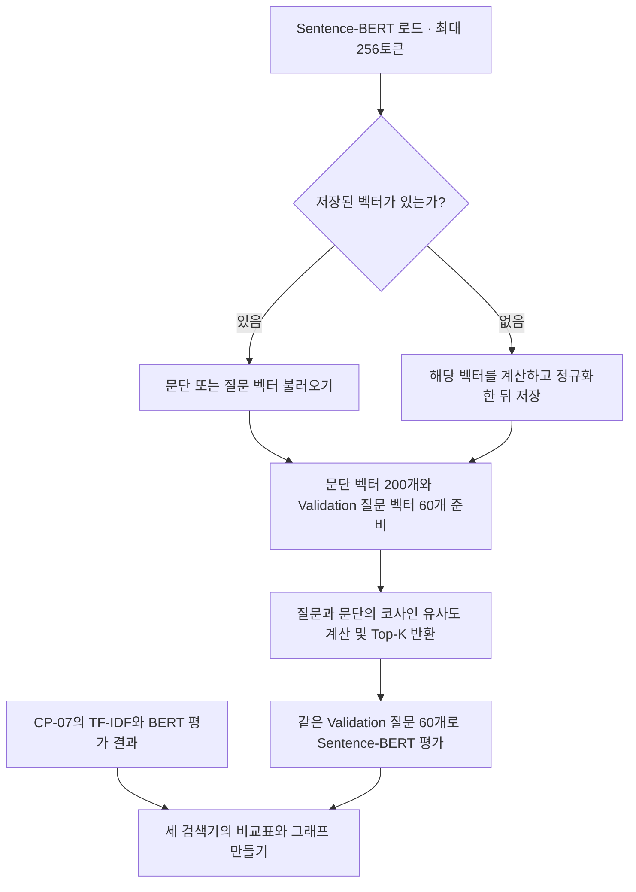

| 검색 방식 | Hit@1 | Recall@3 | MRR@5 |
| --- | ---: | ---: | ---: |
| TF-IDF | 0.8833 | 0.9667 | 0.9167 |
| BERT | 0.6667 | 0.8333 | 0.7589 |
| Sentence-BERT | 0.7667 | 0.8833 | 0.8208 |

같은 질문 60개에서 세 지표 모두 TF-IDF, Sentence-BERT, BERT 순이었다. 어떤 질문에서 이 차이가 났는지는 CP-09에서 순위와 문자 겹침 비율을 같이 봤다.

## CP-09. 실패 사례 분석 및 검색 방식 선택

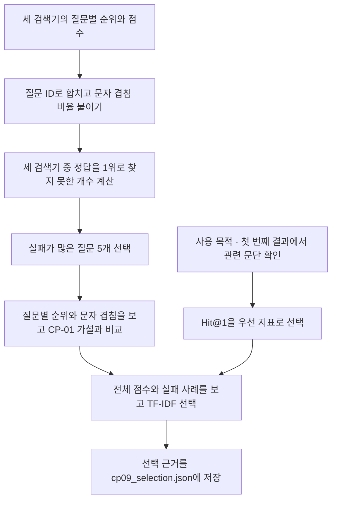

대표 사례 5개의 평균 문자 겹침 비율은 35.7%로, 전체 평균 47.4%보다 11.7%p 낮았다. `QV018`은 겹침 비율이 15.8%였고, 정답 순위는 TF-IDF 3위, BERT 2위, Sentence-BERT 1위였다. `QV020`에서는 세 검색기 모두 정답을 상위 5개에서 놓쳤다.

첫 번째 검색 결과에서 관련 문단을 바로 확인하는 상황으로 정했다. 그래서 `Hit@1`을 우선으로 봤고, Validation에서 53개를 1위로 찾은 TF-IDF를 선택했다.

## CP-10. 최종 검색기와 Test 평가

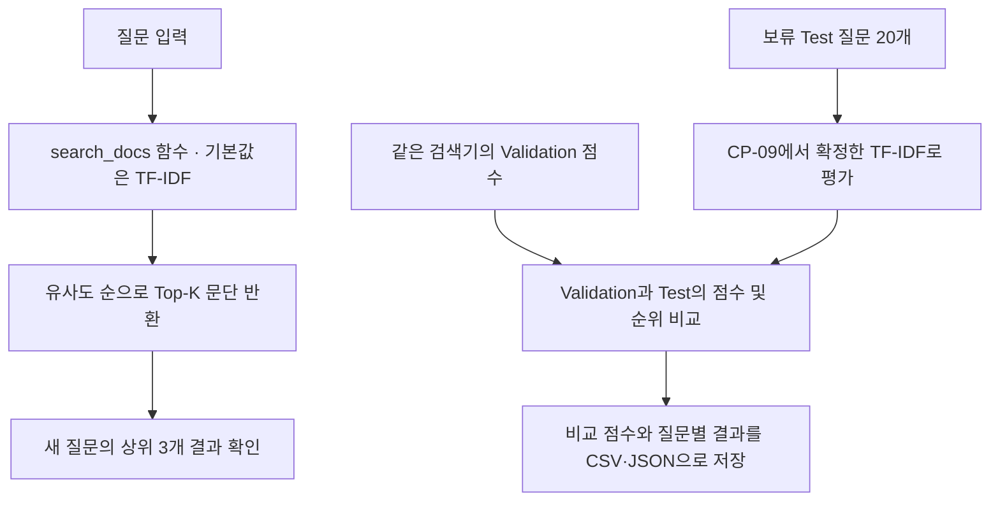

| 지표 | Validation | Test | 감소량 |
| --- | ---: | ---: | ---: |
| Hit@1 | 0.8833 | 0.8000 | 0.0833 |
| Recall@3 | 0.9667 | 0.8000 | 0.1667 |
| MRR@5 | 0.9167 | 0.8125 | 0.1042 |

Test 질문 20개 중 16개에서 정답을 1위로 찾았다. 나머지 4개 중 하나는 정답이 4위였고, 세 개는 상위 5개에 정답이 없었다. 검색 대상은 같은 문단 200개였고, CP-10에서는 새 질문으로 확정된 검색 방식을 평가했다.
